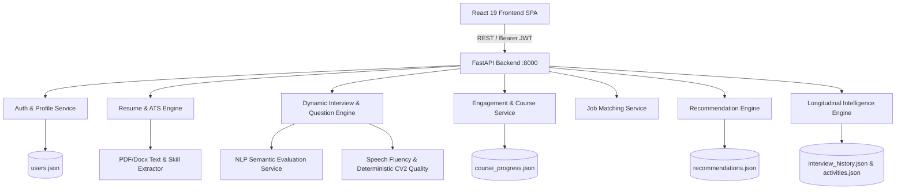

# PREPRIA — System Architecture & Data Flow Documentation
**Document Version:** 1.0.0  
**Date:** September 2026  
**Platform:** PREPRIA — AI Career Intelligence Platform

---

## 1. High-Level Architecture Overview

PREPRIA is architected as a decoupled, multi-tier intelligence platform comprising:
1. **Frontend Client:** React 19 SPA built with Vite, TailwindCSS, Framer Motion, Lucide icons, and Recharts.
2. **Backend API Gateway & Business Services:** Python FastAPI REST server providing authentication, ATS processing, question generation, course progress validation, analytics aggregation, job matching, personalized recommendation intelligence, and longitudinal mastery tracking.
3. **ML / Intelligence Services:** Python-based evaluation engines encompassing semantic text similarity, deterministic CV2 face/quality monitoring (`OpenCV`), speech pause/filler detection, and Whisper audio transcription.
4. **Data Persistence Layer:** JSON-backed file database (`users.json`, `course_progress.json`, `activities.json`, `interview_history.json`, `recommendations.json`) with backup (`.bak`) and atomic temporary write protections, designed for transition to relational SQL/PostgreSQL in production.



---

## 2. Component Subsystems

### 2.1 Frontend Architecture
- **Framework:** React 19 with React Router v7.
- **State Management:** React Context (`UserContext`, `ThemeContext`) combined with scoped `localStorage` persistence (`profile_{email}`, `preferences_{email}`, `interview_history_{email}`).
- **Proctoring Engine:** Client-side custom hook (`useInterviewProctoring.js`) capturing Page Visibility, window blur, MediaStream audio/video tracks, display media screen sharing, and canvas skin-tone pixel heuristics with 5-second grace periods and a 3-warning threshold.
- **Audio / Speech Interface:** Browser Web Speech API (`webkitSpeechRecognition` / `SpeechRecognition`) with dedicated accumulation buffers (`resultIndex` iteration) to prevent transcript duplication.
- **Visual Design:** High-contrast modern dark/light themes with TailwindCSS utilities, curated typography (`Manrope`, `Poppins`, `Inter`), and responsive card grids.

### 2.2 Backend Architecture
- **Framework:** FastAPI with Uvicorn ASGI server.
- **Authentication & Security:** JWT HS256 authentication with token expiration, Google OAuth token verification, password reset tokens, and rate-limited in-memory OTP verification (`OTPManager`).
- **File Uploads:** `python-multipart` handling PDF resume files with `pdfplumber` text extraction and heuristic skill/experience/education parser.
- **Course & Certification Verification:** `engagement_service.py` performing server-side validation of lesson duration, quiz answer keys, module gating, and certificate generation.
- **Job Matching:** Multi-parameter candidate scoring algorithm calculating skill overlap, role relevance, and career level alignment against a catalog of 200+ jobs.

---

## 3. End-to-End Data Flows

### Flow 1: Authentication & Profile Bootstrap
```
User (Login/Signup) 
  → POST /auth/login or /auth/signup
  → auth_service.py (validate credentials / generate JWT)
  → Response (access_token + user payload)
  → UserContext.jsx (stores token, caches user profile)
  → UI Navigation to /dashboard
```

### Flow 2: Resume Upload & ATS Parsing
```
User Uploads PDF Resume 
  → POST /upload-resume (multipart/form-data + Bearer Auth)
  → resume_service.py -> extract_text (pdfplumber)
  → skill_extractor.py (extracts skills, keywords, experience, projects, education)
  → calculate_ats_score & generate_feedback
  → auth_service.py: update_user_profile (attaches ATS score & skills to user in users.json)
  → Response -> ResumeIntelligence.jsx / ATSDashboard.jsx
```

### Flow 3: Role Interview Setup & Question Sequencing
```
Candidate Selects Target Role & Round
  → PracticePrerequisite.jsx (checks camera, mic, screen share permissions)
  → InterviewScreen.jsx (loads role catalog & question bank)
  → Question read aloud via SpeechSynthesis
  → Candidate speaks -> SpeechRecognition (interim + final transcript buffer)
  → Candidate submits answer -> userAnswers array stored
```

### Flow 4: Interview Evaluation & Zero-Answer Protection
```
Interview Concluded (All questions answered or terminated)
  → evaluateInterviewSubmission (interviewQuestionEngine.js)
  → IF validAnswerCount == 0:
       Return { isValid: false, message: "No responses submitted" }
       UI displays "Interview Not Completed - No Responses Submitted"
       NO fake scores or charts created.
  → IF validAnswerCount > 0:
       Calculates 5-dimension scorecard (Technical, Problem Solving, Communication, Role Knowledge, Confidence)
       Saves to interview_history_{email} in localStorage
       POST /api/analytics/activity/record (logs interview completion to backend)
       UI displays comprehensive performance report.
```

### Flow 5: Learning Hub Progress & Certificate Verification
```
Candidate Takes Course / Lesson
  → CoursePlayer.jsx (tracks lesson dwell time & quiz answers)
  → POST /analytics/course/progress
  → engagement_service.py (validates quiz answers against questionKey, checks required duration)
  → Persists to course_progress.json
  → Candidate Navigates to /certificate/:courseId
  → GET /analytics/course/certificate/:userId/:courseId
  → Server validates all modules & quizzes passed -> Returns { eligible: true }
  → Certificate.jsx renders authenticated certificate & PDF download.
```

### Flow 6: Executive Dashboard & Longitudinal Aggregation
```
Candidate Navigates to /dashboard
  → GET /analytics/dashboard/:userId
  → analytics_routes.py -> get_dashboard
  → Combines engagement metrics (streak, weekly heatmap, hours) + growth analytics (interview trends)
  → Response -> Dashboard.jsx renders KPI cards, progress line charts, and activity feeds.
```
