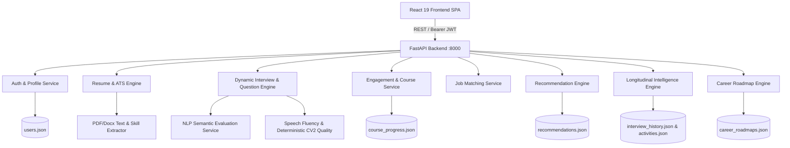

# PREPRIA — System Architecture & Data Flow Documentation
**Document Version:** 1.0.0  
**Date:** September 2026  
**Platform:** PREPRIA — AI Career Intelligence Platform

---

## 1. High-Level Architecture Overview

PREPRIA is architected as a decoupled, multi-tier intelligence platform comprising:
1. **Frontend Client:** React 19 SPA built with Vite, TailwindCSS, Framer Motion, Lucide icons, and Recharts.
2. **Backend API Gateway & Business Services:** Python FastAPI REST server providing authentication, ATS processing, question generation, course progress validation, analytics aggregation, job matching, personalized recommendation intelligence, longitudinal mastery tracking, and dynamic evidence-grounded career roadmap derivation.
3. **ML / Intelligence Services:** Python-based evaluation engines encompassing semantic text similarity, deterministic CV2 face/quality monitoring (`OpenCV`), speech pause/filler detection, and Whisper audio transcription.
4. **Data Persistence Layer:** JSON-backed file database (`users.json`, `course_progress.json`, `activities.json`, `interview_history.json`, `recommendations.json`, `career_roadmaps.json`) with backup (`.bak`) and atomic temporary write protections, designed for transition to relational SQL/PostgreSQL in production.




---

## 2. Component Subsystems

### 2.1 Frontend Architecture
- **Framework:** React 19 with React Router v7.
- **State Management:** React Context (`UserContext`, `ThemeContext`) combined with scoped `localStorage` persistence (`profile_{email}`, `preferences_{email}`, `interview_history_{email}`).
- **Proctoring Engine (Phase 16 Hardened):** Client-side custom hook (`useInterviewProctoring.js`) capturing Page Visibility, window blur, MediaStream audio/video tracks, display media screen sharing, and canvas skin-tone spatial distribution heuristics (computing centroid $(\bar{x}, \bar{y})$ and horizontal/vertical mass asymmetry). Detects `FACE_NOT_DETECTED`, `HEAD_OUT_OF_FRAME`, `HEAD_TURNED_LEFT`, `HEAD_TURNED_RIGHT`, `HEAD_TURNED_UP`, and `HEAD_TURNED_DOWN` with a 4.5s/5s temporal grace period, single-event lock against repeated counter inflation, and strict 3-warning auto-termination limit.
- **Audio / Speech Interface:** Browser Web Speech API (`webkitSpeechRecognition` / `SpeechRecognition`) with dedicated accumulation buffers (`resultIndex` iteration) to prevent transcript duplication.
- **Visual Design:** High-contrast modern dark/light themes with TailwindCSS utilities, curated typography (`Manrope`, `Poppins`, `Inter`), and responsive card grids.

### 2.2 Backend Architecture
- **Framework:** FastAPI with Uvicorn ASGI server.
- **Authentication & Security:** JWT HS256 authentication with token expiration, Google OAuth token verification, password reset tokens, and rate-limited in-memory OTP verification (`OTPManager`).
- **File Uploads:** `python-multipart` handling PDF resume files with `pdfplumber` text extraction and heuristic skill/experience/education parser.
- **Course & Certification Verification:** `engagement_service.py` performing server-side validation of lesson duration, quiz answer keys, module gating, and certificate generation.
- **Job Matching:** Multi-parameter candidate scoring algorithm calculating skill overlap, role relevance, and career level alignment against a catalog of 200+ jobs.

---

## 3. End-to-End Data Flows

### Flow 1: Authentication & Profile Bootstrap
```
User (Login/Signup) 
  → POST /auth/login or /auth/signup
  → auth_service.py (validate credentials / generate JWT)
  → Response (access_token + user payload)
  → UserContext.jsx (stores token, caches user profile)
  → UI Navigation to /dashboard
```

### Flow 2: Resume Upload & ATS Parsing
```
User Uploads PDF Resume 
  → POST /upload-resume (multipart/form-data + Bearer Auth)
  → resume_service.py -> extract_text (pdfplumber)
  → skill_extractor.py (extracts skills, keywords, experience, projects, education)
  → calculate_ats_score & generate_feedback
  → auth_service.py: update_user_profile (attaches ATS score & skills to user in users.json)
  → Response -> ResumeIntelligence.jsx / ATSDashboard.jsx
```

### Flow 3: Role Interview Setup & Question Sequencing
```
Candidate Selects Target Role & Round
  → PracticePrerequisite.jsx (checks camera, mic, screen share permissions)
  → InterviewScreen.jsx (loads role catalog & question bank)
  → Question read aloud via SpeechSynthesis
  → Candidate speaks -> SpeechRecognition (interim + final transcript buffer)
  → Candidate submits answer -> userAnswers array stored
```

### Flow 4: Interview Evaluation & Zero-Answer Protection
```
Interview Concluded (All questions answered or terminated)
  → evaluateInterviewSubmission (interviewQuestionEngine.js)
  → IF validAnswerCount == 0:
       Return { isValid: false, message: "No responses submitted" }
       UI displays "Interview Not Completed - No Responses Submitted"
       NO fake scores or charts created.
  → IF validAnswerCount > 0:
       Calculates 5-dimension scorecard (Technical, Problem Solving, Communication, Role Knowledge, Confidence)
       Saves to interview_history_{email} in localStorage
       POST /api/analytics/activity/record (logs interview completion to backend)
       UI displays comprehensive performance report.
```

### Flow 5: Learning Hub Progress & Certificate Verification
```
Candidate Takes Course / Lesson
  → CoursePlayer.jsx (tracks lesson dwell time & quiz answers)
  → POST /analytics/course/progress
  → engagement_service.py (validates quiz answers against questionKey, checks required duration)
  → Persists to course_progress.json
  → Candidate Navigates to /certificate/:courseId
  → GET /analytics/course/certificate/:userId/:courseId
  → Server validates all modules & quizzes passed -> Returns { eligible: true }
  → Certificate.jsx renders authenticated certificate & PDF download.
```

### Flow 6: Executive Dashboard & Longitudinal Aggregation
```
Candidate Navigates to /dashboard
  → GET /analytics/dashboard/:userId
  → analytics_routes.py -> get_dashboard
  → Combines engagement metrics (streak, weekly heatmap, hours) + growth analytics (interview trends)
  → Response -> Dashboard.jsx renders KPI cards, progress line charts, and activity feeds.
```

### Flow 7: Server-Generated Interview PDF Evaluation Report
```
Candidate Clicks "Download PDF Report" on Evaluation Screen (InterviewScreen.jsx / InterviewFeedback.jsx)
  → GET /api/interview/report/{session_id}/pdf (Authorization: Bearer <JWT>)
  → interview_routes.py: download_interview_report_pdf
  → Verifies authenticated JWT ownership & multi-user isolation
  → Retrieves session evaluation from performance_tracker.py (interview_history.json)
  → interview_report_pdf_service.py: generate_interview_pdf_report
  → Renders Title, 5-Pillar Scorecards, Speech Metrics (WPM, Fillers, Breakdown), Question Audit, and Strengths/Improvements
  → Returns binary PDF stream (application/pdf) with Content-Disposition: attachment
  → Browser prompts secure native file download (prepria-interview-report-{session_id}.pdf)
```

### Flow 8: Head Pose / Looking-Away Proctoring & Auto-Termination
```
Candidate in Interview Session (InterviewScreen.jsx)
  → useInterviewProctoring.js runs local canvas analysis every 1200ms (160x120 buffer, <1ms overhead, zero frame uploads)
  → Calculates skin-tone pixel mass, centroid (cx, cy), and left/right mass asymmetry:
       - If mass < 280: FACE_NOT_DETECTED
       - If cx < 0.20 or cx > 0.80 or cy < 0.14 or cy > 0.86: HEAD_OUT_OF_FRAME
       - If cx < 0.30 or left_ratio > 2.8: HEAD_TURNED_LEFT
       - If cx > 0.70 or right_ratio > 2.8: HEAD_TURNED_RIGHT
       - If cy < 0.22: HEAD_TURNED_UP
       - If cy > 0.78: HEAD_TURNED_DOWN
  → Temporal Persistence Engine (Grace Period):
       - Transient movements (< 4.5s) are cleared upon returning to centered posture
       - Sustained deviation (>= 4.5s) triggers a proctoring warning with neutral, objective messaging
       - Single-violation active lock prevents continuous deviations from repeatedly incrementing warnings
  → State Machine:
       - Warning 1: Displays warning banner & sound alert; interview continues
       - Warning 2: Displays warning banner & sound alert; interview continues
       - Warning 3: Triggers handleAutoTermination -> Submits interview -> Generates evaluation / PDF report
```

### Flow 9: Conversational Voice Turn-Taking & Silence Finalization
```
Candidate in Interview Session (InterviewScreen.jsx)
  → State 1 (AI_SPEAKING): System reads active question aloud using SpeechSynthesisUtterance.
       - Prevents overlapping utterances via speechSynthesis.cancel().
       - Prevents STT from capturing AI speech.
  → State 2 (LISTENING): On utterance.onend, SpeechRecognition automatically activates in continuous mode.
       - Audio stream coexists with proctoring monitor without track contention.
  → State 3 (CANDIDATE_SPEAKING): Candidate speaks; SpeechRecognition streams chunks without duplication.
       - Real-time transcript populates answer workspace.
  → State 4 (FINALIZING_ANSWER): Candidate pauses naturally.
       - When candidate has spoken >= 5 words and pauses for >= 3.2s, silence detector triggers finalization.
       - Clears speech buffers, stops recognition, and auto-submits answer.
       - Zero-answer defense: If candidate says nothing (< 5 words), silence detector does NOT auto-submit.
```

### Flow 10: Grounded Learning Recommendations & External Provider Boundaries
```
Candidate Performance & Profile Evidence (Resume ATS, Mock Interviews, Competency Scores)
  → recommendation_service.py deterministically extracts verified skill gaps (e.g. Technical weakness, Score < 60%)
  → Generates stable deterministic recommendation ID: rec_<hash(email:type:topic)>
  → Mappings:
       - Native Courses (PREPRIA Learning Hub): Full dwell time, interactive code/quizzes, exam, and verified certificate.
            * Automatically updates recommendation status to 'completed' upon course pass.
       - External Resources (Coursera, Infosys Springboard, edX, Udemy): Labeled as 'external' with verified HTTPS resource links.
```

### Flow 11: Longitudinal Intelligence & Multi-Session Progression Tracking
```
Multi-Session Lifecycle (Interviews 1..N, Course Progress, Recommendations)
  → longitudinal_service.py deterministically aggregates historical evidence:
       - Score & 5-Pillar Trends (Technical, Problem Solving, Communication, Role Knowledge, Confidence)
       - Weakness Lifecycle: First detected -> Recurring (>= 2 sessions) -> Resolved (later score >= 75%)
       - Mastery Progression: Emerging -> Developing -> Improving -> Consistent -> Strong (score >= 85%)
       - Learning Intervention Correlation:
            * Baseline interview topic score before course
            * Course completion timestamp in course_progress.json
            * Subsequent interview topic score -> Score delta & outcome (non-causal, objective)
       - Adaptive Interview & Roadmap Feeding:
            * Unresolved persistent weaknesses receive higher recommendation & interview priority
            * Mastered topics avoid redundant remediation questions
```

### Flow 12: Unified End-to-End Product Intelligence Lineage (Phase 20)
```
Resume Upload / Profile Context (resume_service.py)
  ↓ Extracted Skills & ATS Score persisted to users.json (Backend authoritative)
Interview Configuration & Question Generation (interview_service.py)
  ↓ Contextualized by Target Role & ATS Skills (no hallucinated skills)
Adaptive Interview Execution (InterviewScreen.jsx)
  ↓ Local Canvas Head Pose / Proctoring, SpeechRecognition STT & Synthesis TTS, 3.2s Silence Finalization
Interview Submission & 5-Pillar Evaluation (interview_evaluation_service.py)
  ↓ Authoritative scoring (Technical, Problem Solving, Communication, Role Knowledge, Confidence) & Speech Metrics
Evaluation Persistence & PDF Report Generation (performance_tracker.py & interview_report_pdf_service.py)
  ↓ Weakness & Topic Evidence persisted to interviews.json (Owner: JWT email)
Grounded Learning Recommendations (recommendation_service.py)
  ↓ Deterministic SHA-256 ID (rec_<hash>), Native (PREPRIA Hub) vs. External Provider (Coursera/Springboard/edX)
Learning Hub Progression & Verified Completion (engagement_service.py)
  ↓ Dwell Time Enforcement, Quizzes, Verified Certificate & Synchronized Recommendation Status
Longitudinal Intelligence Engine (longitudinal_service.py)
  ↓ 5-Pillar Progression, Weakness Lifecycle (recurring/resolved), Mastery, and Pre/Post Intervention Tracking
Future Interview Adaptive Targeting & Remediation (interview_service.py)
  ↓ Prioritizes unresolved persistent gaps; avoids redundant mastered topics
Career Roadmap Progression & Evidence-Grounded Readiness (career_roadmap_service.py)
  ↓ Progressive Milestone Unlocking, Explainable Multi-Pillar Readiness Grounded in Verified History
```

### End-to-End Subsystem State Ownership Matrix
| Subsystem / Transition | Source of Truth | Persisted Entity | Authoritative Owner | Security / Identity Constraint |
| --- | --- | --- | --- | --- |
| **Resume & Profile** | `resume_service.py` | `users.json` | Authenticated Candidate | JWT `sub` / `email` claim |
| **Interview Configuration** | `interview_service.py` | In-memory / dynamic | Authenticated Candidate | Target role validation against catalog |
| **Interview Execution & Voice** | `InterviewScreen.jsx` | Session State | Candidate browser | Web Audio / STT buffers isolated per turn |
| **5-Pillar Evaluation** | `interview_evaluation_service.py` | `interviews.json` | Backend Evaluation Service | Deterministic NLP + Speech Metrics scoring |
| **Interview PDF Report** | `interview_report_pdf_service.py` | Ephemeral PDF stream | Authoritative Session Owner | 403 Forbidden on tenant mismatch |
| **Skill Evidence & Gaps** | `interview_evaluation_service.py` | `interviews.json` | Evaluated Session Record | Grounded strictly in question performance |
| **Learning Recommendations** | `recommendation_service.py` | `recommendations.json` | Candidate Profile | Deterministic SHA-256 ID, no fabricated courses |
| **Learning Hub Progress** | `engagement_service.py` | `course_progress.json` | Candidate Course Record | Minimum dwell time + quiz pass required |
| **Longitudinal Profile** | `longitudinal_service.py` | Dynamic aggregation | Multi-session Analytics | Strictly multi-session comparison, no causal bias |
| **Adaptive Targeting** | `interview_service.py` | Dynamic question pool | Active Interview Session | Prioritizes unresolved persistent weaknesses |
| **Career Roadmap** | `career_roadmap_service.py` | `career_roadmaps.json`| Candidate Career Profile| Unlocked exclusively by authentic evidence |

### Flow 13: Automated Browser Acceptance & E2E Testing Harness (Phase 21)
```
Playwright Test Runner (frontend/playwright.config.js)
  ├── Fixture Layer: Deterministic Candidate A/B credentials & isolated localStorage injection
  ├── Browser Environment: Headless Chromium with fake media streams (--use-fake-ui-for-media-stream)
  ├── Server Targets: Vite Frontend (http://localhost:5173) + FastAPI Backend (http://localhost:8000)
  ├── Spec Coverage:
  │    ├── smoke.spec.js (Landing -> Login -> Dashboard -> Clean Logout)
  │    ├── phase13_learning_hub.spec.js (Catalog, Lesson Player, Dwell & Gating)
  │    ├── phase14_speech_ui.spec.js (Speech analysis HUD, WPM & Filler density)
  │    ├── phase15_pdf_report.spec.js (Evaluation report & Server PDF generation)
  │    ├── phase16_proctoring.spec.js (Canvas proctoring HUD & 3-warning termination)
  │    ├── phase17_voice_turn_taking.spec.js (Turn-taking lifecycle & manual fallback)
  │    ├── phase18_recommendations.spec.js (Grounded recommendation cards & provider badges)
  │    ├── phase19_longitudinal.spec.js (5-Pillar Scorecard charts & intervention history)
  │    ├── phase20_career_roadmap.spec.js (Target role selector & evidence milestones)
  │    ├── phase20_closed_loop_e2e.spec.js (Full Closed Loop Product Journey)
  │    └── security_isolation.spec.js (Cross-Tenant Authenticated Session Isolation)
  └── Artifact Outputs: HTML Test Report, JSON Metrics, Screenshot & Trace on Failure
```

